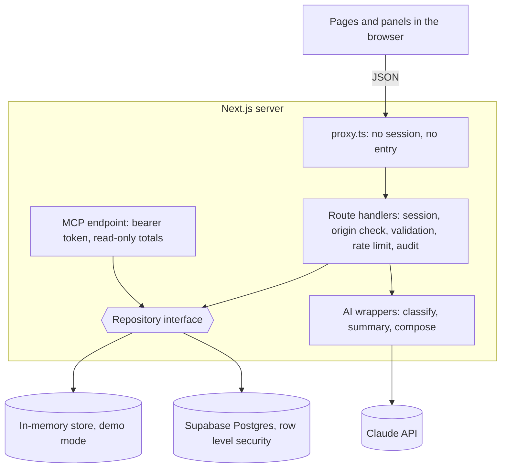

# Implementation Plan: Filing Problem Tracker

**Branch**: `001-filing-problem-tracker` | **Date**: 2026-11-10 | **Spec**: [spec.md](spec.md)

**Input**: Feature specification from `/specs/001-filing-problem-tracker/spec.md`

## Summary

A standalone web app where clerks tag rejected filings and court leaders read the patterns. It runs in two modes behind one code path: demo mode on made-up data kept in memory, and Supabase mode on Postgres for a pilot. Pages and routes call `getSession()` and `getRepository(session)` and never ask which mode is active. AI is used in three narrow, validated ways and the app works without it.



## Technical Context

**Language/Version**: TypeScript (strict), Node 22

**Primary Dependencies**: Next.js 16 (App Router, `cacheComponents`), React 19, Zod 4, `@supabase/supabase-js` and `@supabase/ssr`, `@anthropic-ai/sdk`, `@modelcontextprotocol/sdk`

**Storage**: Supabase Postgres with row level security; an in-memory store seeded with 900 made-up filings in demo mode

**Testing**: Vitest (`tests/unit`), Vitest with PGlite running the real migrations (`tests/rls`), Playwright with axe against a production build in demo mode (`e2e`)

**Target Platform**: Any Node host; current browsers on desktop and phone

**Project Type**: Web application, single Next.js project

**Performance Goals**: Filter changes are instant because panels are computed in the browser; new entries reach other users within 30 seconds

**Constraints**: No personal data; no legal advice; usable with AI off; WCAG AA; no connection to court systems; secrets on the server only

**Scale/Scope**: Pilot scale, thousands of records, tens of users

**Security model**:

- Run mode comes from the environment (`src/server/config.ts`). Both Supabase settings set means Supabase mode, neither means demo mode, and one alone stops the server at startup with a plain message. A production start in demo mode needs `DEMO_COOKIE_SECRET` or `ALLOW_DEMO=1`.
- Sign-in. Demo mode is an open role picker; the choice is kept in a signed, `httpOnly` cookie for 8 hours, so demo mode must only hold made-up data. Supabase mode emails a one-time link, by invitation only: a person with no `profiles` row can read and write nothing. The link opens `/auth/confirm`, and the token is used only when the person presses Sign in, so a mail scanner cannot use it up.
- Every request is checked twice. `src/proxy.ts` sends a page request without a session to `/login` and answers an API request with 401. Each page and route handler then calls `requireSession`, which decides. Reachable signed out: `/login`, `/auth/*`, `/api/auth/*`, `/api/health`, `/api/demo/login`, `/api/demo/logout`, and `/api/mcp`, which checks its own bearer token.
- Access rules live in the data layer, written twice: SQL policies in `supabase/migrations` and the same table in `src/server/repo/memory.ts` ([data-model.md](data-model.md)). The Supabase repository acts as the signed-in person, never with the service role key.
- Route handlers run inside `handle()` (`src/server/http.ts`): a state-changing request must come from the app's own origin, the body is parsed with a strict Zod schema, errors return a plain message and a request id, and one JSON log line per request holds no body text. Changes are written to the audit log with free text removed.
- Notes, imported reasons, import batch names and workspace requests go through the personal-data check in `src/lib/pii.ts`; names and descriptions of recorded changes get the same check without the name pattern.
- Limits: 60 changes and 20 AI requests per person per minute by default, sign-in attempts per network address, request bodies up to 6 MB, a CSV up to 5 MB and 10,000 rows.
- Secrets (`ANTHROPIC_API_KEY`, `SUPABASE_SERVICE_ROLE_KEY`, `MCP_TOKEN`, `DEMO_COOKIE_SECRET`) are read only in `src/server`, where every module imports `server-only`. `npm run check:bundle` fails when a secret name, a secret value or server code is found in the browser bundle. The service role key is used in one file, `src/server/mcp/supabase-tokens.ts`.
- Response headers are set in `next.config.ts`: a Content-Security-Policy that allows this origin only, `frame-ancestors 'none'`, `X-Frame-Options: DENY`, `X-Content-Type-Options: nosniff`, `Referrer-Policy`, `Permissions-Policy`, `Cross-Origin-Opener-Policy`, and `Strict-Transport-Security` outside `next dev`.

**Known limits**:

- The Content-Security-Policy allows inline scripts, because pages are prerendered with `cacheComponents` and a prerendered shell cannot carry a per-request nonce.
- Rate limits are kept in the memory of one server process.
- The personal-data check is pattern matching and runs in the app, not in the database.
- Removing an entry hides the row and keeps it. There is no purge.
- No second factor, no single sign-on, and no screen for managing accounts or MCP tokens.
- Supabase mode has been tested against Postgres in memory (PGlite), not against a hosted project.

## Constitution Check

*GATE: Must pass before research. Re-check after design.*

| Principle | How this plan meets it |
|---|---|
| I. No personal data | No name or case-number field. Free text is checked in the browser and on the server. |
| II. No legal advice | Fixed problem labels; system prompts forbid advice; no litigant-facing page. |
| III. AI chooses, code computes | One `computePanel` function produces every number. AI output is schema-validated; summaries are checked against their input. |
| IV. Works with the AI off | Keyword rules for sorting and for choosing panels; "Summary unavailable" for the summary. |
| V. Access rules in the data layer | Row level security policies, mirrored in the in-memory store, both tested. |
| VI. Outside court systems | Data enters by clicks or pasted exports only. |
| VII. Plain and accessible | Tokens and rules in [contracts/ui.md](contracts/ui.md); axe runs on every page in both themes. |

No violations.

## Project Structure

### Documentation (this feature)

```text
specs/001-filing-problem-tracker/
├── spec.md
├── plan.md
├── research.md
├── data-model.md
├── quickstart.md
├── contracts/
│   ├── http-api.md
│   ├── ai.md
│   └── ui.md
└── tasks.md
```

### Source Code (repository root)

```text
src/
├── lib/           # pure code: lists, schemas, statistics, CSV, personal-data check, panel contract
├── server/        # server only: config, sessions, repositories, AI wrappers, MCP, audit, rate limit
├── app/           # pages and api/**/route.ts
├── components/    # React components
├── fonts/         # self-hosted typefaces
├── proxy.ts       # first session check on every request
└── instrumentation.ts  # loads the config at startup and exits on a bad one
supabase/          # migrations, seed, sign-in email templates, local CLI config
tests/             # unit tests and access-rule tests
e2e/               # browser tests
scripts/           # bundle check, seed generator, static demo build
docs/              # README images and the single-file demo
```

**Structure Decision**: One Next.js project. Imports point one way: `app -> components -> lib` and `app -> server -> lib`. `src/lib` does no I/O and never reads the clock; "today" is always passed in. Client components never import `src/server`, which keeps secrets and server logic out of the browser.

## Complexity Tracking

| Violation | Why Needed | Simpler Alternative Rejected Because |
|---|---|---|
| Two repository implementations | Zero-setup demo and CI, plus a real database for a pilot | A database-only app needs accounts and secrets to try or test |
| Access rules written twice (SQL and in-memory) | Demo mode must enforce the rules it demonstrates | An unprotected demo would hide authorization bugs until the pilot |
