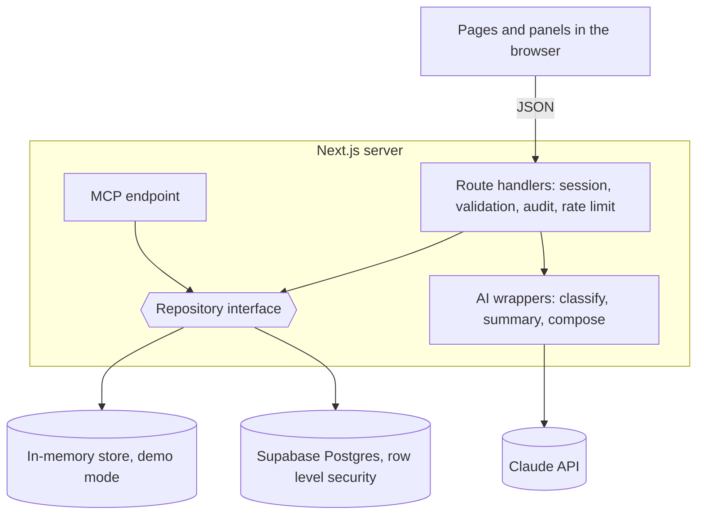

# Implementation Plan: Filing Problem Tracker

**Branch**: `001-filing-problem-tracker` | **Date**: 2026-11-10 | **Spec**: [spec.md](spec.md)

**Input**: Feature specification from `/specs/001-filing-problem-tracker/spec.md`

## Summary

A standalone web app where clerks tag rejected filings and court leaders read the patterns. It runs in two modes behind one code path: a demo mode on made-up data and a database mode for a pilot. AI is used in three narrow, validated ways and the app works without it.



## Technical Context

**Language/Version**: TypeScript, Node 22

**Primary Dependencies**: Next.js 16 (App Router), Zod, Supabase client, Anthropic SDK, MCP SDK

**Storage**: Supabase Postgres with row level security; in-memory store in demo mode

**Testing**: Vitest (unit), PGlite (access rules against the real migrations), Playwright with axe (browser)

**Target Platform**: Any Node host; modern browsers on desktop and phone

**Project Type**: Web application, single Next.js project

**Performance Goals**: Filter changes are instant (computed in the browser); new entries reach other users within 30 seconds

**Constraints**: No personal data; no legal advice; usable with AI off; WCAG AA; no connection to court systems; secrets server-side only

**Scale/Scope**: Pilot scale, thousands of records, tens of users

## Constitution Check

*GATE: Must pass before research. Re-check after design.*

| Principle | How this plan meets it |
|---|---|
| I. No personal data | No name or case-number field. Notes and imported text are checked in the browser and on the server. |
| II. No legal advice | Fixed problem labels; system prompts forbid advice; no litigant-facing page. |
| III. AI chooses, code computes | One `computePanel` function produces every number. AI output is schema-validated; summaries are checked against their input. |
| IV. Works with the AI off | Keyword rules for sorting and for choosing panels; "Summary unavailable" for the summary. |
| V. Access rules in the data layer | Row level security policies, mirrored in the in-memory store, both tested. |
| VI. Outside court systems | Data enters by clicks or pasted exports only. |
| VII. Plain and accessible | Tokens in [contracts/ui.md](contracts/ui.md); axe runs on every page in both themes. |

No violations.

## Project Structure

### Documentation (this feature)

```text
specs/001-filing-problem-tracker/
├── spec.md
├── plan.md
├── research.md
├── data-model.md
├── quickstart.md
├── contracts/
└── tasks.md
```

### Source Code (repository root)

```text
src/
├── lib/         # pure domain code: lists, schemas, stats, CSV, personal-data check, panel contract
├── server/      # server-only: repositories, sessions, AI wrappers, audit, rate limit, config
├── app/         # pages and api/**/route.ts
└── components/  # React components
supabase/        # migrations and seed
tests/           # unit and access-rule tests
e2e/             # browser tests
```

**Structure Decision**: One Next.js project. Imports point one way: `app -> components -> lib` and `app -> server -> lib`. Client components never import `src/server`, which keeps secrets and server logic out of the browser.

## Complexity Tracking

| Violation | Why Needed | Simpler Alternative Rejected Because |
|---|---|---|
| Two repository implementations | Zero-setup demo and CI, plus a real database for a pilot | A database-only app needs accounts and secrets to try or test |
| Access rules written twice (SQL and in-memory) | Demo mode must enforce the rules it demonstrates | An unprotected demo would hide authorization bugs until the pilot |
