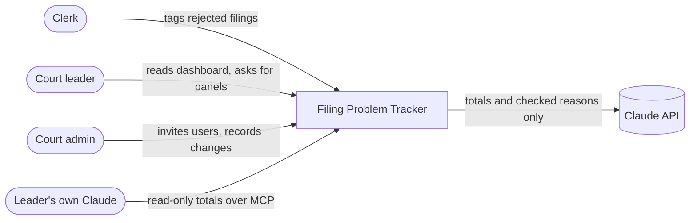
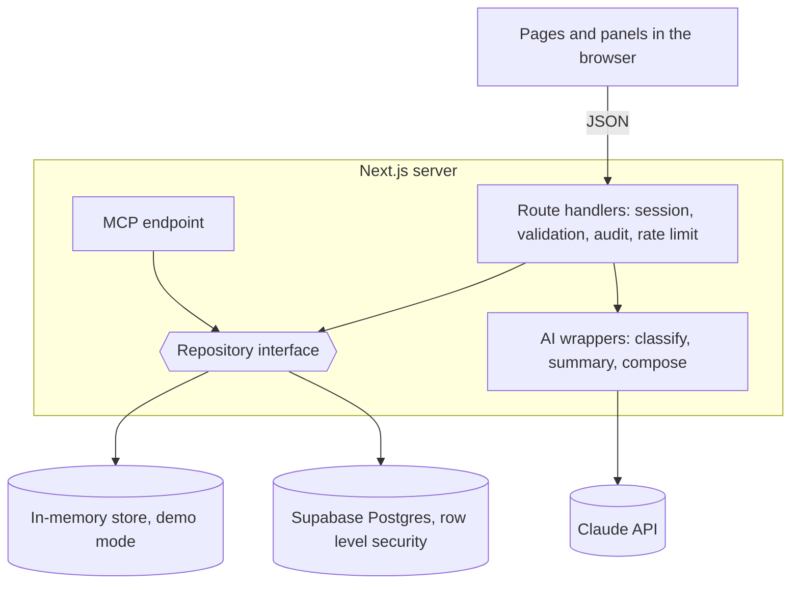

# Implementation Plan: Filing Problem Tracker

**Branch**: `001-filing-problem-tracker` | **Date**: 2026-11-10 | **Spec**: [spec.md](spec.md)

## Summary

A standalone web app where clerks tag rejected filings and court leaders read the patterns. It runs in two modes behind one code path: a demo mode on made-up data and a database mode for a pilot. AI is used in three narrow, validated ways and the app works without it.

## Technical Context

**Language/Version**: TypeScript, Node 22
**Primary Dependencies**: Next.js 16 (App Router), Zod, Supabase client, Anthropic SDK, MCP SDK
**Storage**: Supabase Postgres with row level security; in-memory store in demo mode
**Testing**: Vitest (unit), PGlite (access rules against the real migrations), Playwright with axe (browser)
**Target Platform**: Any Node host; modern browsers on desktop and phone
**Project Type**: Web application, single Next.js project
**Performance Goals**: Filter changes are instant (computed in the browser); new entries reach other users within 30 seconds
**Constraints**: No personal data; no legal advice; usable with AI off; WCAG AA; no connection to court systems
**Scale/Scope**: Pilot scale, thousands of records, tens of users

## Constitution Check

| Principle | How this plan meets it |
|---|---|
| I. No personal data | No name or case-number field. `findPersonalData` runs on notes and imported text in the browser and on the server. |
| II. No legal advice | Fixed problem labels; system prompts forbid advice; no litigant-facing page. |
| III. AI chooses, code computes | One `computePanel` function produces every number. AI output is schema-validated; summaries are checked against their input. |
| IV. Works with the AI off | Keyword rules for sorting and for choosing panels; "Summary unavailable" for the summary. |
| V. Access rules in the data layer | Row level security policies, mirrored in the in-memory store, both tested. |
| VI. Outside court systems | Data enters by clicks or pasted exports only. |
| VII. Plain and accessible | Design system in `design-system/MASTER.md`; axe runs on every page in both themes. |

No violations.

## Architecture





## Project Structure

### Documentation (this feature)

```
specs/001-filing-problem-tracker/
  spec.md            what and why
  plan.md            this file
  research.md        decisions and alternatives
  data-model.md      tables, access rules, repository interface
  contracts/         http-api.md, ai.md, ui.md
  source-layout.md   file-by-file responsibilities
  quickstart.md      how to run and check it
  tasks.md           build steps and status
```

### Source Code (repository root)

```
src/lib/         pure domain code: lists, schemas, stats, CSV, personal-data check, panel contract
src/server/      server-only: repositories, sessions, AI wrappers, audit, rate limit, config
src/app/         pages and api/**/route.ts
src/components/  React components
supabase/        migrations and seed
tests/           unit and access-rule tests
e2e/             browser tests
```

**Structure Decision**: One Next.js project. Imports point one way: `app -> components -> lib` and `app -> server -> lib`. Client components never import `src/server`, which keeps secrets and server logic out of the browser. Detail in [source-layout.md](source-layout.md).

## Security and testing

- Secrets are server-only. A build check fails CI if a secret name appears in the browser bundle.
- Security headers include a content security policy and `frame-ancestors 'none'`. State-changing routes check the request origin. Every page and route requires a session on the server.
- Production refuses to start in demo mode unless explicitly allowed.
- Rate limits: 20 AI requests and 60 changes per user per minute.
- Unit tests cover the domain code, the in-memory store's access rules and the AI wrappers with a mocked SDK. Access-rule tests run the real migrations and check every cell of the access table as each kind of user. Browser tests cover each user story, keyboard use, accessibility and phone width.

## Complexity Tracking

| Added complexity | Why needed | Simpler alternative rejected because |
|---|---|---|
| Two repository implementations | Zero-setup demo and CI, plus a real database for a pilot | A database-only app needs accounts and secrets to try or test |
| Access rules written twice (SQL and in-memory) | Demo mode must enforce the same rules it demonstrates | An unprotected demo would hide authorization bugs until the pilot |
